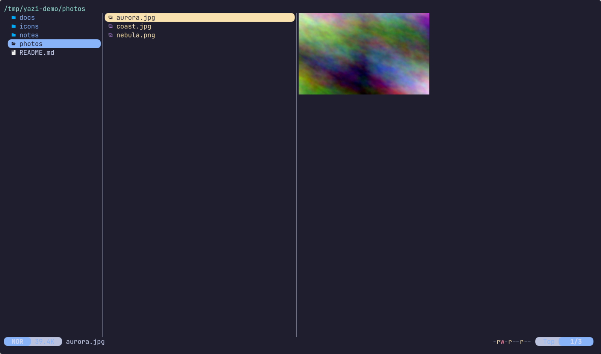
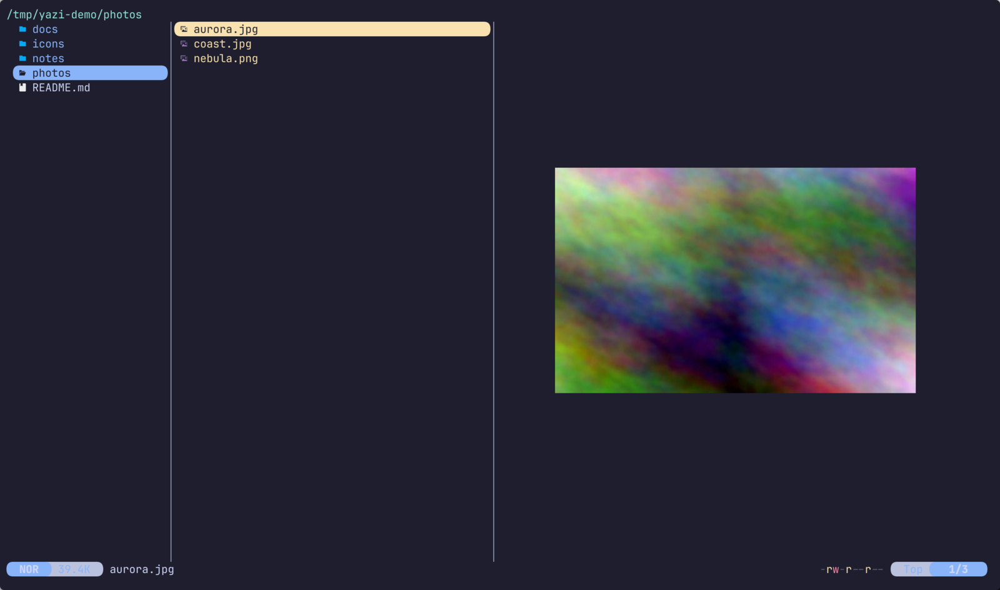
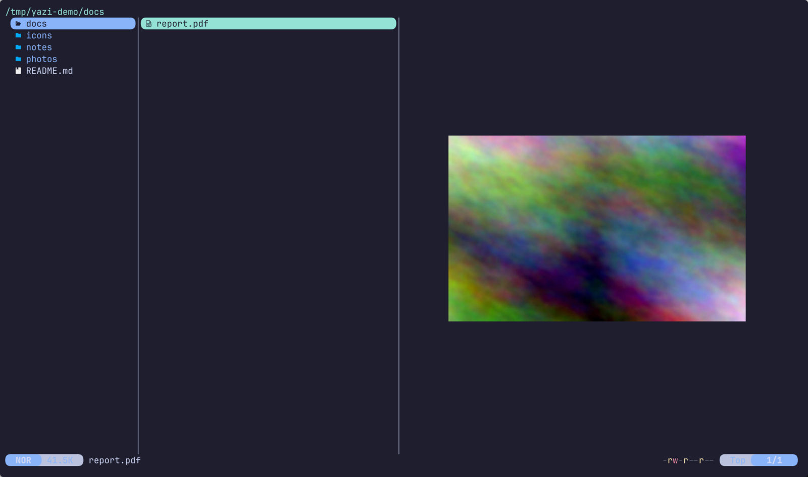
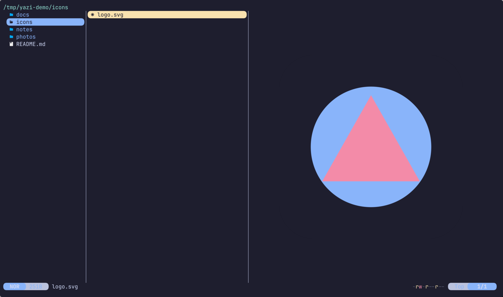

# viewer.yazi

> Centered, enlarged previews of images, SVGs and PDF pages for Yazi.

[](https://github.com/yazi-contrib/viewer.yazi/actions/workflows/ci.yml) [](https://github.com/yazi-contrib/viewer.yazi/releases) [](LICENSE)

## Screenshots

Without the plugin, Yazi draws the image from the corner of the pane, as large as the image is:



With `viewer.yazi`, the image is enlarged to fill most of the pane and sits in the middle:



The same for the pages of a PDF and for SVG files:





## Dependencies

- [Yazi](https://yazi-rs.github.io) (the latest release)
- [imagemagick](https://imagemagick.org) - to make the larger copy of an image (`magick`)
- [resvg](https://github.com/linebender/resvg) - for SVG files, as Yazi's own SVG previewer needs it
- [poppler](https://poppler.freedesktop.org) (`pdftoppm`) - for PDF files, as Yazi's own PDF previewer needs it

## Installation

```sh
ya pkg add yazi-contrib/viewer
```

Or by hand, into the folder of your configuration of Yazi:

```sh
git clone https://github.com/yazi-contrib/viewer.yazi ~/.config/yazi/plugins/viewer.yazi
```

## Usage

Add the rules to `yazi.toml`. Each one runs a built-in previewer of Yazi through this plugin:

```toml
[plugin]
prepend_previewers = [
  { mime = "image/{jpeg,png,gif,webp,bmp,tiff}", run = "viewer image" },
  { mime = "application/pdf", run = "viewer pdf" },
  { mime = "image/svg+xml", run = "viewer svg" },
]
```

The argument is the name of the built-in previewer to run: `image`, `pdf` or `svg`.

The image is made larger, up to what the pane has room for, and drawn in the middle of it. The larger copy
is made with ImageMagick and kept in `$TMPDIR/yazi-viewer`, so a second look at the same image is instant.
A reboot clears the folder.

## Configuration

The options are arguments of the previewer rule in `yazi.toml`:

```toml
[plugin]
prepend_previewers = [
  { mime = "image/{jpeg,png,gif,webp,bmp,tiff}", run = "viewer image --max_up=4 --fill=0.75" },
]
```

| Option     | Default | Meaning                                                              |
|------------|---------|----------------------------------------------------------------------|
| `--max_up` | `4`     | The most that an image is enlarged. A small image is soft when it is |
| `--fill`   | `0.75`  | The part of the pane that an image fills, between 0 and 1            |

An image is never drawn larger than `max_width` and `max_height` of the `[preview]` section of `yazi.toml`.

They are arguments and not a call to `setup` in `init.lua`, because Yazi runs a previewer in a Lua state of its
own, where `init.lua` has not run.

## How it works, and what can break

Yazi draws an image from the top left corner of the pane and never makes it larger. This plugin runs the
built-in previewer you name and replaces `ya.image_show` for it, so the image that the previewer draws gets
a larger copy and an area in the middle of the pane. The replacement uses `ya.image_info` and
`rt.term.cell_size`, which the published documentation of Yazi does not describe. A new release of Yazi can
change them, so the plugin is tested against the latest Yazi in CI, and the supported versions are in the
releases. If the terminal does not say the size of a cell, the image is drawn as Yazi draws it.

## Development

```sh
nix develop
bats tests/
```

The tests start Yazi in a detached tmux session with a configuration of its own that loads the plugin from
this folder, and fail on an error of Lua, a deprecated API, or a start that does not hold.

## The yazi-contrib ecosystem

Plugins of Yazi, one repository for each: `viewer.yazi`, `layout.yazi`, `starship.yazi`.

## License

MIT
